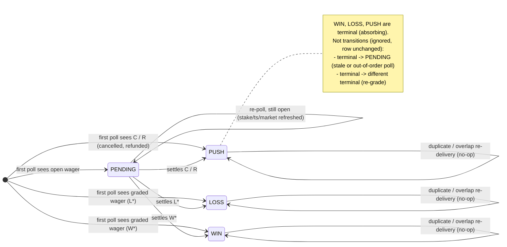

# Bet lifecycle (`bet_history.result`)

Derived from `src/schedules/betHistoryIngest.ts` (the fantasy402 Customer
Performance poller added in PR #7) and its consumers (`f402-bets.ts`,
`f402-transactions.ts`, `populateGraph.ts`, `sharpCalc.ts`). This is the
contract the ingest upsert must enforce;
`tests/unit/bet-lifecycle-model.test.ts` model-checks it against the real ingest
code path.

## Stored states

`bet_history.result` only ever holds four values written by the ingest:
`PENDING`, `WIN`, `LOSS`, `PUSH` (see migration 0003's column comment). There
are **no separate `VOID` / `CANCELLED` states** in the code: the normalizer
collapses them into `PUSH` (stake returned, payout = stake).

| fantasy402 `WagerStatus` (upper-cased)  | stored `result` | stored `payout`       |
| --------------------------------------- | --------------- | --------------------- |
| starts with `W`                         | `WIN`           | `stake + ToWinAmount` |
| starts with `L`                         | `LOSS`          | `0`                   |
| exactly `C` (cancelled) or `R` (refund) | `PUSH`          | `stake`               |
| anything else (`P`, empty, unknown)     | `PENDING`       | `0`                   |

Rows with no wager number, or a non-positive / non-numeric stake, are dropped
before they reach the state machine (they cannot be deduped). Identity is
`(cid, wager_number)` (partial unique index from migration 0009).

## Statechart

### Re-grade

The code has **no re-grade transition**: nothing in the repo models a book
changing a graded wager's outcome (`WIN -> LOSS` after a stat correction, etc.),
and no consumer expects a settled row's result to change. Terminal states are
therefore **absorbing**: the first settlement observed wins and every later
delivery of the same `(cid, wager_number)` is a no-op. If fantasy402 re-grades
turn out to happen, add an explicit `terminal -> terminal'` edge here and in the
upsert's `WHERE` guard together; do not just drop the guard.

### Why out-of-order matters

The poller re-fetches a 24 h overlap window every 5 minutes and runs customers
concurrently, so the same wager can be delivered many times and a response
produced before settlement can be applied after one produced after settlement.
The guard on the upsert (`WHERE bet_history.result = 'PENDING'`) makes the
transition function order-insensitive for every sequence that contains at most
one distinct terminal outcome: `PENDING` deliveries never overwrite a terminal
row, and terminal deliveries always overwrite a `PENDING` row.

## Invariants (checked by the model test)

1. **Exactly-once terminal**: a wager whose delivery sequence contains a
   terminal status ends in that terminal state, and once a row is terminal it
   never changes again (no flapping, no double settlement).
2. **No dropped transition**: a row stored as `PENDING` that is later delivered
   as settled is updated to that settled state, with the matching payout.
3. **No illegal transition**: the only state changes ever observed are
   `(none) -> any` and `PENDING -> {PENDING, WIN, LOSS, PUSH}`.
4. **One row per wager**: duplicates never create a second row.

## Known gaps at PR #7 head (`f941a66`), before the fixes on this branch

- **Fixed on this branch** (guarded `ON CONFLICT DO UPDATE`): `INSERT OR IGNORE`
  made the first delivery permanent, so `PENDING -> WIN/LOSS/PUSH` is
  **dropped** (invariant 2 fails); rows stay `PENDING` with `payout = 0` forever
  and inflate the in-flight counts in `f402-bets.ts` / `populateGraph.ts`.
- **Fixed on this branch** (window reaches back to the oldest stored `PENDING`
  wager): the incremental window started 24 h before the customer's newest
  stored wager. If the report's date range filters on placement date
  (`InsertDateTime`, the only date the normalizer reads), a wager that stays
  open longer than that (futures, long-dated props) is never re-fetched and
  cannot settle even with a correct upsert.
